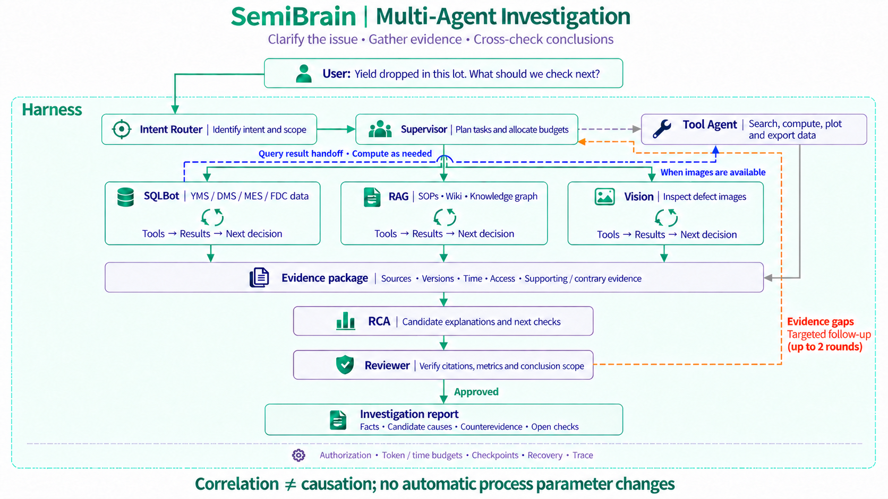
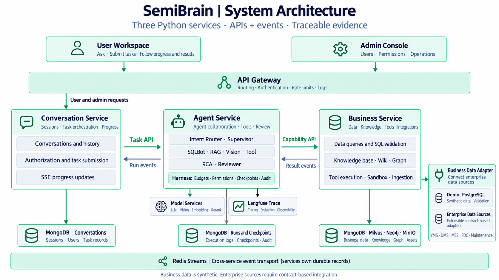

<div align="center">


# SemiBrain

### An AI investigation and knowledge workspace for semiconductor engineering teams

**Turn engineering questions into evidence, analysis, and deliverables.**

Connect technical documents, test data, process knowledge, and external tools.<br/>
Bring research, yield analysis, coordinated investigation, and reporting into one AI workspace.

<p>
  <a href="README.md"></a>
  <a href="README.en.md"></a>
</p>

<p>
  
  
  
  
  
</p>

**[Live Demo](https://semibrain.net.cn/) · [Use Cases](#scenarios) · [Capabilities](#capabilities) · [Deployment Guide](docs/development.md)**

</div>

---

<a id="why-semibrain"></a>

## ✦ More time for engineering judgment. Less time assembling the evidence.

A yield excursion can span test definitions, process history, equipment alerts, technical documents, and hard-earned experience. Bringing those pieces together often means switching between dashboards, spreadsheets, and files before the investigation can even begin.

**SemiBrain connects that work into one continuous flow: understand the question → gather evidence → analyze and compute → coordinate and review → deliver the results.**

| A familiar engineering challenge | What changes with SemiBrain |
| :--- | :--- |
| Knowledge is scattered across PDFs, documents, spreadsheets, and training material | Search around the question and bring relevant passages, original figures, and sources directly into the analysis |
| CP / FT, first / final test, program versions, and time windows make comparisons ambiguous | Carry metric definitions into interpretation and queries, with visible numerators, denominators, units, and time boundaries |
| Data queries, process research, alert checks, and plotting become separate manual jobs | Let agents connect authorized data, knowledge, and computation into a traceable investigation |
| Useful methods live in the heads of a few experienced engineers | Capture them in reviewed Wiki pages, entity relationships, and reusable Skills |
| A finished analysis still needs another round of copying, charting, and formatting | Deliver answers, citations, charts, and files together, with Markdown, Word, and PDF exports |
| An AI conclusion is difficult to inspect or debug | Follow it back through source material, tool execution, model calls, and the run trace |

> **Spend less effort finding information, moving numbers, and assembling reports—and more on evaluating evidence, validating hypotheses, and deciding what to do next.**

<a id="audience"></a>

## Who is it for?

| Audience | Where to start |
| :--- | :--- |
| **Test, product, and yield engineers** | Understand CP, FT, Bin, Site, and test programs; compare consistent metrics and organize yield investigations |
| **Process and equipment engineers** | Explore relationships among process steps, equipment, alerts, and maintenance actions with supporting sources |
| **Quality and reliability engineers** | Assemble specifications and verification methods; separate observations, interpretations, and open questions |
| **Technical leads and knowledge owners** | Manage document and Wiki versions, publication, and applicability; turn team experience into reusable knowledge |
| **New engineers and cross-functional collaborators** | Learn terminology, workflows, and upstream/downstream relationships through natural-language questions and citations |
| **Enterprise AI and data platform teams** | Connect data and external capabilities through governed interfaces for semiconductor-focused agent applications |

<a id="scenarios"></a>

## Six ways to put engineering AI to work

### 01 · Understand CP and FT—and follow the answer back to its sources

> “What do CP and FT test? Why should first-test and final-test yield be compared carefully?”

Build an explanation from the knowledge base and engineering Wiki, covering test stages, objects, and metric boundaries. Use the cited sources to continue learning or align definitions across teams.

### 02 · Cross-check process knowledge with public sources

> “Compare ALD and CVD using the knowledge base and public technical material.”

With web access enabled, agents search and read public pages alongside existing documents. Differences, conflicting descriptions, and missing evidence remain visible for further judgment.

### 03 · Explore engineering relationships, one entity at a time

> “How are CP wafer testing, probers, probe cards, ATE, and FT related?”

Use entity relationships to locate supporting passages, or explore the graph directly through local views and incremental neighbor expansion. See both the connection and the material that supports it.

### 04 · Investigate yield excursions across data, process history, and alerts

> “Compare the specified lots using consistent yield definitions. Review process history and FDC alerts, then list candidate explanations and next validation steps.”

A Supervisor coordinates specialist agents: SQLBot retrieves business data, RAG finds engineering references, and Tool handles needed computation. Their work is synthesized and reviewed into a result the team can discuss and investigate further.

### 05 · Calculate with Python and take the results with you

> “Calculate yield differences from these test results, plot a comparison, and export a CSV.”

Run calculations on authorized inputs in an isolated Python sandbox and produce actual charts and data files. Downstream computation reads the query results themselves instead of relying on numbers copied back into a conversation.

### 06 · Create illustrated engineering notes

> “Prepare an etching note explaining wet and dry etching, with original figures from the knowledge base and source references.”

Bring prose, figures, citations, and limitations together, then export the result as Markdown, Word, or PDF for learning, technical discussion, or investigation records.

> Lots, yield measurements, and alerts in the online demo use **synthetic semiconductor business data**. Enterprise systems can be integrated through the governed business-service interfaces.

<a id="capabilities"></a>

## 🧠 Core capabilities

### Three modes, from a quick question to a coordinated investigation

| Mode | Best suited for | How it works |
| :--- | :--- | :--- |
| **Quick Q&A** | Concepts, document reading, summaries, and simple queries with clear definitions | A focused routing and retrieval path produces answers with sources |
| **Investigation · Single Agent** | Questions that require successive searches, tool calls, and evidence gathering | One investigator advances the task through a tool loop, then prepares and checks the answer |
| **Investigation · Multi-Agent** | Multiple objectives, specialist capabilities, data dependencies, or computational deliverables | A Supervisor plans the work, specialists collaborate, and the result is synthesized and reviewed |

**Follow-ups carry meaning.** Requests such as “switch to final test,” “CP only,” or “keep the same window” pass through conversation understanding and slot validation. When the topic changes, the system re-evaluates which earlier constraints still apply.

### Agents that divide the work and hand off real results

<p align="center">
  <a href="docs/assets/semibrain-multi-agent-collaboration.en.png">
    
  </a>
</p>

<p align="center"><sub>A typical complex investigation · Click the image for full resolution</sub></p>

Specialists are selected as needed. Independent branches can run in parallel, while dependencies use query jobs, evidence, and file handles for handoff. Task progress, failures, and collected evidence inform subsequent coordination, keeping collaboration structured and inspectable.

### Business analysis grounded in semiconductor definitions

- **Keep CP and FT distinct:** test stage, program, and data scope are part of the query.
- **Compare first and final test consistently:** account for the device cohort, time window, data cutoff, and retest definition.
- **Make results checkable:** expose numerators, denominators, ratios, and units; compute statistics from authorized results.
- **Investigate in context:** bring test results, process history, FDC alerts, and engineering references into the same task.
- **Separate levels of evidence:** distinguish observations, correlations, candidate causes, and conclusions that still need validation.

### Knowledge base × Wiki × Graph

| Capability | What it enables |
| :--- | :--- |
| **Multi-format knowledge base** | Ingest PDFs, Word documents, images, Excel, PowerPoint, XMind, EPUB, Markdown, and more while retaining content, figures, and source locations |
| **Hybrid retrieval** | Combine semantic and keyword retrieval, reranking, and context expansion for abbreviations, identifiers, and natural-language questions |
| **Engineering Wiki** | Draft pages from selected sources, review and publish them, and retain applicability, references, and versions |
| **Engineering knowledge graph** | Extract source-supported entities and relationships from published documents and Wiki pages, with human curation and incremental exploration |
| **Publication and version control** | Track revisions, previews, publication, withdrawal, and restoration; check current access and versions when reading or citing |

### Skills and MCP bring methods and tools into the workflow

**Skills make working methods reusable.** Package analytical procedures, knowledge-use instructions, and reviewed Python scripts as versioned capabilities that agents load and execute within their permissions.

**MCP connects external capabilities.** Integrate remote Streamable HTTP / SSE services, configure tool permissions centrally, and let users choose the services available to each investigation.

Both use **progressive disclosure**: start with a concise capability description, then load the instructions or parameter schema needed for the task. Keep more of the model’s context focused on the work at hand.

### Personal memory for the way you work

Retain preferences and professional background you have confirmed—for example, “lead with the conclusion, then explain the evidence.” Background extraction proposes candidates for you to review, edit, and confirm before later conversations use them.

Memory can be turned off, and the current request takes priority. Team knowledge belongs in the knowledge base and Wiki; personal preferences belong in personal memory.

### Inspect the process. Keep the deliverables.

- **Source-linked answers:** trace statements to original passages, versions, and locations.
- **Portable results:** export answers as Markdown, Word, or PDF, and download computational artifacts such as charts and CSV files.
- **Visible execution:** inspect stages, model calls, and tool calls in the workspace; administrators can open the full Langfuse trace.
- **Managed context:** compact long histories and read precise details back through persistent evidence handles.
- **Observable optimization:** use stable prompt prefixes, on-demand loading, read-only request reuse, and frontend caching to reduce repeated work.
- **Ongoing quality engineering:** combine independent numerical oracles, frozen evaluation sets, human quality labels, and run metrics to investigate failures and verify improvements.

<a id="try-it"></a>

## 🚀 Get started

**[Open the SemiBrain live demo →](https://semibrain.net.cn/)**

1. **Choose a question.** Start with a scenario card or ask your own engineering question.
2. **Choose a working mode.** Use Quick Q&A for focused requests, or Investigation for evidence gathering and analysis. Enable multi-agent collaboration, web search, or MCP when useful.
3. **Inspect and reuse the result.** Check citations and the run trace, ask a follow-up, or export the analysis.

A few questions to try:

```text
Explain the test objects, workflows, and yield boundaries of CP and FT using the knowledge base. Cite the sources for each distinction.

Use the engineering graph to explain how probers, probe cards, ATE, and CP testing relate. Separate source-supported relationships from open questions.

Calculate first-test and final-test yield from the data I provide. Show the numerators and denominators, then generate a comparison chart and CSV.
```

<a id="architecture"></a>

## ⚙️ Built for extensible engineering workflows

<p align="center">
  <a href="docs/assets/semibrain-system-architecture.en.png">
    
  </a>
</p>

<p align="center"><sub>Three Python services · APIs and events · Click the image for full resolution</sub></p>

| Layer | Components |
| :--- | :--- |
| User experience | Vue 3 workspace and administration console, with desktop and mobile layouts |
| Conversation service | Identity, conversations, authorization, and streamed presentation |
| Agent service | Intent routing, single/multi-agent orchestration, prompts, evidence, review, and memory |
| Business service | Governed queries, retrieval, ingestion, graph, Wiki, sandbox, Skills, and MCP |
| Data and runtime | MongoDB · PostgreSQL · Milvus · Neo4j · MinIO · Redis / Celery · Docker · Langfuse |

Each service owns its data and collaborates through authenticated APIs. MongoDB holds governance and runtime records, Milvus and Neo4j provide rebuildable retrieval/graph projections, and MinIO manages source and generated assets.

**Deploy in your own environment.** Adapt business interfaces to systems such as MES, YMS, and FDC, and configure model providers, retrieval services, and external tools for the deployment.

### Local development

Prerequisites: Python 3.12.13, uv 0.12.0, Node.js 24.19.x, and pnpm 11.19.0.

```bash
git clone https://github.com/Tim-888888/SemiBrain.git
cd SemiBrain

uv sync --frozen --all-packages
pnpm install --frozen-lockfile
pnpm build
```

These commands install dependencies and build the frontend. Complete workflows also need storage, service environments, model configuration, workers, and the gateway. Follow the **[development and deployment guide](docs/development.md)** for setup.

<a id="documentation"></a>

## 📚 Documentation and engineering resources

| Guide | Topics |
| :--- | :--- |
| [Development and deployment](docs/development.md) | Service startup, storage, configuration, parsing, and recovery |
| [Agent configuration and evaluation](docs/agent-configuration.md) | Role models, intent cards, reviewed configuration, and quality records |
| [MCP services](docs/mcp-operations.md) | External connections, tool permissions, and invocation governance |
| [Skills](docs/skills-operations.md) | Capability definitions, review, publication, and script execution |
| [Personal memory](docs/memory-operations.md) | Personal notes, candidate confirmation, and usage boundaries |
| [Report exports](docs/report-export.md) | Markdown, Word, PDF, and image assets |
| [Recovery rehearsal](docs/recovery-rehearsal.md) | Backup and recovery verification in an isolated environment |

---

<div align="center">

**Connect scattered knowledge. Organize the evidence. Make each investigation a stronger starting point for the next.**

Interested in semiconductors × agents? [Star the project](https://github.com/Tim-888888/SemiBrain) or [share feedback](https://github.com/Tim-888888/SemiBrain/issues).

[简体中文](README.md) · [English](README.en.md) · [Live Demo](https://semibrain.net.cn/)

</div>
