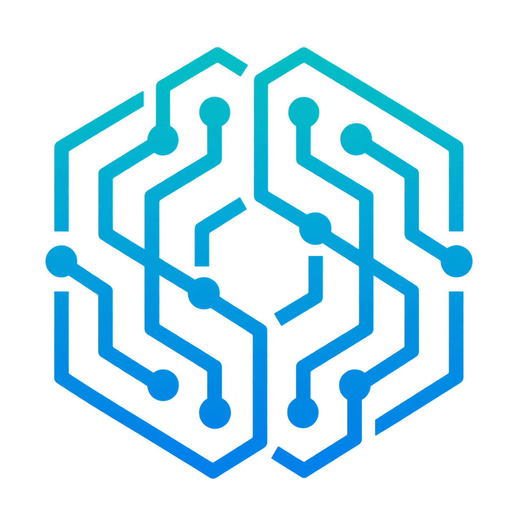
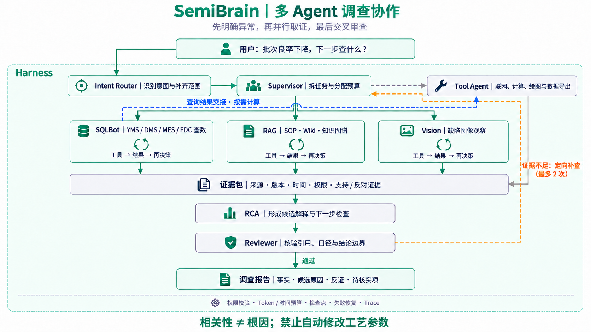
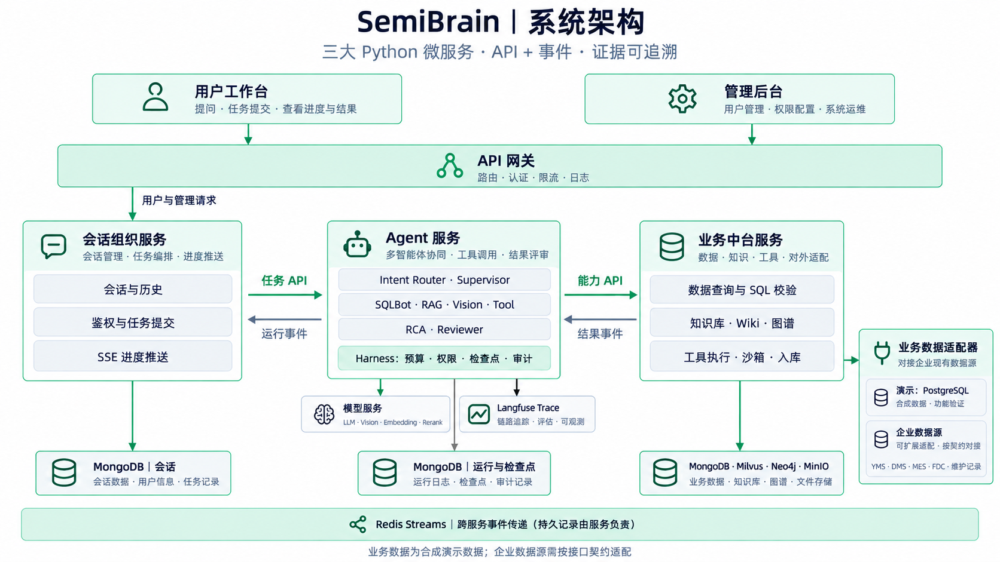

<div align="center">



# SemiBrain

### 面向半导体工程团队的 AI 调查与知识协作平台

**让知识有出处，让分析有依据，让工程问题走向可交付的成果。**

连接工程文档、测试数据、工艺知识与外部工具，<br/>
将资料检索、良率分析、协同调查和报告交付，汇聚到一个 AI 工作台。

<p>
  <a href="README.md"></a>
  <a href="README.en.md"></a>
</p>

<p>
  
  
  
  
  
</p>

**[在线体验](https://semibrain.net.cn/) · [应用场景](#scenarios) · [核心能力](#capabilities) · [部署指南](docs/development.zh-CN.md)**

</div>

---

<a id="why-semibrain"></a>

## ✦ 为工程判断减负，把时间留给真正的问题

一条良率异常背后，可能同时涉及测试口径、工艺履历、设备告警、知识文档和历史经验。工程师往往需要在多个页面、表格和文件之间来回切换，才能把线索拼到一起。

**SemiBrain 把这些工作组织成一条连续的任务链：理解问题 → 获取证据 → 分析计算 → 协同核对 → 交付成果。**

| 工程现场的常见难题 | SemiBrain 带来的改变 |
| :--- | :--- |
| 资料散落在 PDF、Word、表格和培训文档里，找得到文件，找不到答案 | 直接围绕问题检索，带上相关段落、原图和出处，让资料进入分析过程 |
| CP / FT、首测 / 终测、程序版本和时间窗口混在一起，数字难比较 | 将业务口径纳入理解与查询，展示分子、分母、单位和时间边界，让比较有共同基准 |
| 查数据、查工艺、找告警、画图各做一遍，手工串联费时 | Agent 按任务调用数据、知识和计算工具，把分散步骤串成可追踪的调查 |
| 排查经验依赖少数资深工程师，每次交接都要重新解释 | 用 Wiki、实体关系和可复用 Skill 沉淀方法，让经验能够被发现、引用和复用 |
| 分析做完还要整理材料、重画图、复制到报告 | 把回答、引用、图表和文件一起交付，支持 Markdown、Word、PDF 与计算结果下载 |
| AI 给了一个结论，却不知道依据是什么、执行过什么 | 从原文引用一路追到模型、工具与运行链路，让结论可核对、问题可定位 |

> **减少重复查找、手工搬数和报告整理，让工程师更专注于证据判断、异常验证与改善行动。**

<a id="audience"></a>

## 谁适合使用？

| 用户 | 可以从哪里开始 |
| :--- | :--- |
| **测试 / 产品 / 良率工程师** | 理解 CP、FT、Bin、Site 与测试程序，比较同口径指标，组织良率异常调查 |
| **工艺 / 设备工程师** | 查工序、设备、告警和维护动作之间的关系，结合原文形成排查依据 |
| **质量 / 可靠性工程师** | 汇总规范和验证方法，区分事实、推断与待验证项，形成带出处的分析材料 |
| **技术负责人 / 知识管理者** | 管理文档与 Wiki 的版本、发布和适用范围，把团队经验沉淀为可复用知识 |
| **新入职工程师 / 跨专业协作者** | 用自然语言理解术语、流程与上下游关系，沿引用继续学习 |
| **企业 AI / 数据平台团队** | 以受控工具接口连接数据与外部能力，构建贴近半导体业务的 Agent 应用 |

<a id="scenarios"></a>

## 六个场景，打开工程 AI 的工作方式

### 01 · 看懂 CP 与 FT，回答后还能继续追出处

> “CP 和 FT 分别测什么？首测良率、终测良率为什么不能混着比较？”

从知识库与工程 Wiki 中组织解释，给出测试阶段、对象和统计边界，并把结论连接到原始资料。适合术语查询、新人学习和跨团队口径沟通。

### 02 · 联网核对工艺知识，让内部资料与公开信息相互补充

> “结合知识库与公开资料，比较 ALD 和 CVD 的特点及适用场景。”

在用户开启联网后，Agent 搜索、读取公开网页，并与已有资料一起整理证据。来源不同、描述冲突或信息缺失，会在回答中保留说明，方便进一步判断。

### 03 · 沿图谱追关系，从一个术语走到一组工程依据

> “CP 晶圆测试与探针台、探针卡、ATE、FT 分别是什么关系？”

通过工程实体关系定位原文，也可以直接在图谱画布里局部探索、逐步展开邻居。从一个节点出发，看到对象之间如何连接，以及每条关系来自哪里。

### 04 · 调查良率异常，把数据、工艺与告警放到一起看

> “比较指定批次的同口径良率，结合工艺履历和 FDC 告警，列出候选原因与下一步验证动作。”

Supervisor 组织专业 Agent 分工取证：SQLBot 查询业务数据，RAG 查找工程依据，Tool 完成所需计算，随后汇总核对。把异常现象、关联线索和验证建议组织成一份可讨论的调查结果。

### 05 · 用 Python 算一算，让数字变成图表与文件

> “根据这些测试结果计算良率差异，画出对比图，并导出 CSV。”

将授权数据送入隔离的 Python 沙箱，执行计算并生成真实图表和数据文件。下游使用实际查询结果，不依赖模型在对话里重新抄写数列。

### 06 · 生成图文工程笔记，把分析变成可复用成果

> “整理一份半导体刻蚀笔记，说明湿法与干法的区别，引用知识库原图并保留来源。”

把正文、原图、引用和限制组织在一起，继续导出为 Markdown、Word 或 PDF。适合学习材料、技术交流和调查记录整理。

> 在线演示中的批次、良率和告警使用**合成半导体业务数据**。真实企业数据可通过业务服务的受控接口适配接入。

<a id="capabilities"></a>

## 🧠 核心能力

### 三种工作模式，覆盖从随手一问到协同调查

| 模式 | 适合的工作 | 工作方式 |
| :--- | :--- | :--- |
| **快速问答** | 查概念、读资料、总结内容、进行口径明确的简单查询 | 用清晰的路由和检索路径快速组织有出处的回答 |
| **智能调查 · 单 Agent** | 需要连续检索、追问、调用工具和补齐证据的问题 | 一个调查 Agent 持续推进任务，结合证据完成回答与核对 |
| **智能调查 · 多 Agent** | 多目标、跨能力、有数据依赖或计算交付的复杂任务 | Supervisor 规划任务，专业分支协作，汇总后核对事实与交付 |

**对话可以承接修正。**“改成终测”“只看 CP”“沿用刚才窗口”等追问，会进入对话理解与槽位校验；换了话题，也会重新判断哪些历史条件还适用。

### 会分工，也会交接的多 Agent

<p align="center">
  <a href="docs/assets/semibrain-multi-agent-collaboration.zh-CN.png">
    
  </a>
</p>

<p align="center"><sub>复杂调查主流程示意 · 点击图片查看原图</sub></p>

专业角色按任务需要选择，无依赖分支可以并行；数据依赖通过查询作业、证据与文件句柄交接。任务进展、失败原因和已取得的证据共同参与后续协调，让协作过程有结构、可跟踪。

### 懂半导体口径的业务分析

- **CP / FT 分清楚：**阶段、测试程序和数据范围进入查询条件。
- **首测 / 终测可比较：**关注器件队列、时间窗口、数据截至时间与复测口径。
- **结果可复核：**返回分子、分母、比例与单位，支持基于授权结果的统计计算。
- **异常有上下文：**把测试结果、工艺履历、FDC 告警和工程知识放进同一次调查。
- **原因有证据等级：**区分观察事实、关联线索、候选原因与需要继续验证的结论。

### 知识库 × Wiki × 图谱，让知识越用越有组织

| 能力 | 用户价值 |
| :--- | :--- |
| **多格式知识库** | 接纳 PDF、Word、图片、Excel、PPT、XMind、EPUB、Markdown 等资料，保留正文、原图与来源位置 |
| **混合检索** | 结合语义与关键词检索、重排和上下文补全，兼顾半导体缩写、编号与自然语言问题 |
| **工程 Wiki** | 根据所选资料起草知识页，人工审阅后发布，保留来源、适用范围与版本 |
| **工程知识图谱** | 从发布文档和 Wiki 抽取实体关系，结合人工治理，支持概览、局部探索与增量展开 |
| **版本与发布管理** | 文档修订、预览、发布、下架和恢复有记录；读取与引用跟随当前有效权限和版本 |

### Skill 与 MCP，把方法和工具接进工作流

**Skill：让团队的方法能够复用。**把分析步骤、知识使用方法和经过审核的 Python 脚本封装成版本化能力，按需加载、按权限执行。

**MCP：让外部能力成为调查工具。**支持远程 Streamable HTTP / SSE 服务，管理员配置连接与工具权限，用户选择本次可用范围，Agent 按需要发现和调用。

两者都采用**渐进式披露**：先展示简要能力，再加载所需说明或参数结构。让模型把上下文更多地用在当前任务上。

### 长期记忆，让协作更贴合你的工作方式

记住你确认过的表达偏好和工作背景，例如“先给结论，再说明依据”。后台提取候选，由你查看、修改和确认后用于后续会话。

记忆可以关闭，本轮要求优先。团队知识由知识库与 Wiki 承载，个人偏好由个人记忆承载，让复用与个性化各有位置。

### 从结果到过程，都能看清楚

- **有出处的回答：**引用对应原文、版本和资料位置，便于核验与继续阅读。
- **可带走的成果：**回答支持 Markdown / Word / PDF 导出，计算任务可交付图表和 CSV 等资产。
- **可追踪的执行：**站内运行链路展示阶段、模型与工具调用；管理员可进入完整 Langfuse 链路。
- **可控的上下文：**长历史按需压缩，大结果保留读取句柄，关键细节能够回到原文。
- **可观察的优化：**稳定 Prompt 前缀、按需加载、只读请求复用和前端缓存，减少重复传输与重复工作。
- **可持续的质量工程：**结合独立数值 oracle、冻结评测样本、人工质量标注和运行指标，持续定位问题与回归验证。

<a id="try-it"></a>

## 🚀 开始使用

**[打开 SemiBrain 在线体验 →](https://semibrain.net.cn/)**

1. **选一个问题。**从首页体验卡开始，或直接提出你的工程问题。
2. **选一种工作方式。**简单查询用快速问答；需要取证与分析时使用智能调查，按需开启多 Agent、联网或 MCP。
3. **检查并带走结果。**查看引用和运行链路，继续追问，或导出分析材料。

也可以试试这样的提问：

```text
请根据知识库解释 CP 与 FT 的测试对象、流程与良率边界，逐条给出来源。

请沿工程图谱说明探针台、探针卡、ATE 与 CP 测试的关系，区分原文支持和待确认信息。

请根据我提供的数据计算首测与终测良率，说明分子分母，生成对比图和 CSV。
```

<a id="architecture"></a>

## ⚙️ 为可扩展的工程工作流而构建

<p align="center">
  <a href="docs/assets/semibrain-system-architecture.zh-CN.png">
    
  </a>
</p>

<p align="center"><sub>三大 Python 服务 · API 与事件协作 · 点击图片查看原图</sub></p>

| 层次 | 组成 |
| :--- | :--- |
| 交互层 | Vue 3 用户工作台与管理控制台，桌面与移动端适配 |
| 会话服务 | 身份、会话、授权与流式呈现 |
| Agent 服务 | 意图路由、单 / 多 Agent 编排、提示词、证据、审核与记忆 |
| 业务服务 | 业务查询、检索、解析、图谱、Wiki、沙箱、Skill 与 MCP |
| 数据与运行底座 | MongoDB · PostgreSQL · Milvus · Neo4j · MinIO · Redis / Celery · Docker · Langfuse |

服务各自管理数据，通过经过认证的 API 协作。MongoDB 保存治理与运行事实，Milvus 和 Neo4j 承担可重建的检索/图谱投影，MinIO 管理原始资料与生成资产。

**支持部署到自有环境。**业务接口可按既有契约适配 MES、YMS、FDC 等系统；模型、检索与外部工具按部署配置接入。

### 本地开发

环境：Python 3.12.13、uv 0.12.0、Node.js 24.19.x、pnpm 11.19.0。

```bash
git clone https://github.com/Tim-888888/SemiBrain.git
cd SemiBrain

uv sync --frozen --all-packages
pnpm install --frozen-lockfile
pnpm build
```

以上完成依赖安装与前端构建。完整运行还需配置存储、服务环境、模型、worker 与网关，详见 **[开发与部署指南](docs/development.zh-CN.md)**。

<a id="documentation"></a>

## 📚 文档与工程资源

| 文档 | 内容 |
| :--- | :--- |
| [开发与部署](docs/development.zh-CN.md) | 服务启动、存储、环境配置、解析与恢复 |
| [Agent 配置与评测](docs/agent-configuration.zh-CN.md) | 角色模型、意图卡、配置发布和质量记录 |
| [MCP 服务](docs/mcp-operations.zh-CN.md) | 外部服务接入、工具授权与调用治理 |
| [Skills](docs/skills-operations.zh-CN.md) | 能力定义、审核发布和脚本执行 |
| [长期记忆](docs/memory-operations.zh-CN.md) | 个人记忆、候选确认与使用边界 |
| [报告导出](docs/report-export.zh-CN.md) | Markdown、Word、PDF 与图片资产 |
| [恢复演练](docs/recovery-rehearsal.zh-CN.md) | 隔离环境中的备份与恢复验证 |

---

<div align="center">

**把散落的资料连成知识，把分散的线索组织成判断，把一次调查沉淀成下一次的起点。**

如果你也关注半导体 × Agent，欢迎 [Star](https://github.com/Tim-888888/SemiBrain) 或 [提交反馈](https://github.com/Tim-888888/SemiBrain/issues)。

[简体中文](README.md) · [English](README.en.md) · [在线体验](https://semibrain.net.cn/)

</div>
